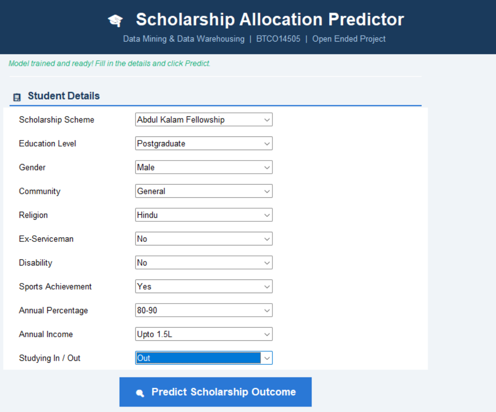
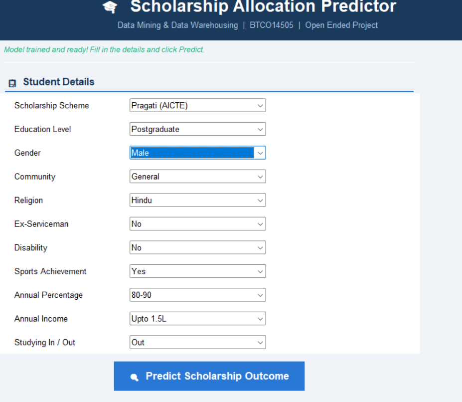
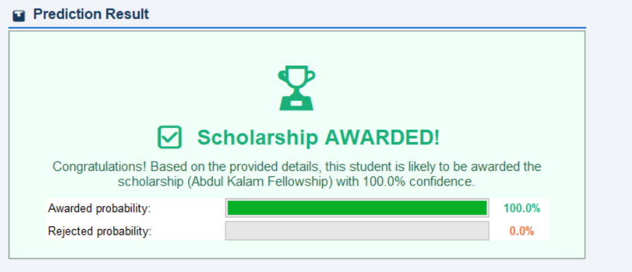
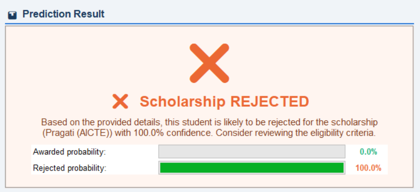

# 🎓 Scholarship Allocation Prediction Using Machine Learning

An end-to-end Data Mining and Machine Learning project for predicting student scholarship allocation eligibility (*Awarded* vs. *Rejected*). Developed as part of the **Data Mining & Data Warehousing (DMDW - BTCO14505)** course at **Sarvajanik College of Engineering & Technology (SCET)**.

---

## 📌 Project Overview & Aim

Higher education scholarships are disbursed through diverse national schemes, each with strict eligibility criteria (academic performance, gender, caste/community, annual family income, disability status, sports achievement, and domicile). 

The goal of this project is to automate and streamline the evaluation of scholarship applications, identifying whether an applicant will be **Awarded (1)** or **Rejected (0)** using predictive classification models.

---

## 📊 Dataset Summary

- **Total Applications:** 245,760 records
- **Features (11 input attributes):**
  - `Scheme`: Scholarship scheme name (10 national schemes)
  - `Education`: Educational qualification (`Undergraduate`, `Postgraduate`, `Doctorate`)
  - `Gender`: `Male`, `Female`
  - `Community`: `General`, `OBC`, `SC/ST`, `Minority`
  - `Religion`: `Hindu`, `Muslim`, `Christian`, `Others`
  - `ExService`: Ex-servicemen quota (`Yes`, `No`)
  - `Disability`: Persons with Disabilities quota (`Yes`, `No`)
  - `Sports`: Sports achievement qualification (`Yes`, `No`)
  - `Percentage`: Academic performance band (`90-100`, `80-90`, `70-80`, `60-70`)
  - `Income`: Annual family income (`Upto 1.5L`, `1.5L to 3L`, `3L to 6L`, `Above 6L`)
  - `India`: Domicile / Study location (`In`, `Out`)
- **Target Variable (`Outcome`):**
  - `0`: Rejected (212,992 applications — 86.7%)
  - `1`: Awarded (32,768 applications — 13.3%)

---

## 🏛️ Supported Scholarship Schemes

1. **INSPIRE-SHE**: Department of Science and Technology (DST) scholarship for basic/natural sciences.
2. **Abdul Kalam Fellowship**: Engineering & technology innovation fellowship for PG and doctoral researchers.
3. **AAI Sports Scheme**: Airports Authority of India athletic scholarship.
4. **Glow & Lovely Foundation**: Scholarship for women from economically backward sections.
5. **NF Disabilities (NFPwD)**: National fellowship for students with benchmark disabilities pursuing higher studies.
6. **ONGC Sports Scheme**: Athletic fellowship for national/state level players.
7. **Pragati (AICTE)**: AICTE technical education scholarship exclusively for girl students.
8. **Dr. Ambedkar Post-Matric**: Financial assistance for Other Backward Classes (OBC) students.
9. **Indira Gandhi Single Girl Child**: UGC scholarship for single girl child pursuing PG degree.
10. **National Overseas Scholarship (NOS)**: Financial assistance for SC/ST students studying overseas.

---

## 🤖 Models & Performance Comparison

| Model | Accuracy | Error Rate | Sensitivity (Recall) | Specificity | Precision | F1-Score |
|---|:---:|:---:|:---:|:---:|:---:|:---:|
| **ID3 Decision Tree (From Scratch)** | **100.00%** | **0.00%** | **100.00%** | **100.00%** | **100.00%** | **1.0000** |
| **Decision Tree (scikit-learn)** | **99.98%** | **0.02%** | **100.00%** | **99.97%** | **99.83%** | **0.9991** |
| **k-Nearest Neighbors (k=5)** | **95.66%** | **4.34%** | **72.31%** | **99.25%** | **93.66%** | **0.8161** |
| **Categorical Naive Bayes** | **88.32%** | **11.68%** | **17.25%** | **99.25%** | **77.98%** | **0.2825** |

> **Key Takeaway:** The Decision Tree models perform exceptionally well because scholarship allocation is deterministic and rule-based. The scratch implementation of ID3 selected `India` as the root attribute based on maximum Information Gain.

---

## 🖥️ Graphical User Interface (GUI)

A multithreaded desktop application built with `Tkinter` and `ttk`:
- Background model loading without UI freezing.
- Dynamic dropdown menus for student attributes.
- Real-time prediction with probability confidence meters.
- Adaptive color schemes (Green for Awarded, Orange for Rejected).

### Application Screenshots

| Homepage / Input Form | Form Options |
|:---:|:---:|
|  |  |

| Awarded Outcome | Rejected Outcome |
|:---:|:---:|
|  |  |

---

## 🚀 How to Run

### 1. Clone the Repository
```bash
git clone https://github.com/MeetTailor-Data/Scholarship_allocation_prediction.git
cd Scholarship_allocation_prediction
```

### 2. Install Dependencies
```bash
pip install pandas numpy scikit-learn openpyxl
```

### 3. Run the GUI Application
```bash
python scholarship_gui.py
```

### 4. Run the Jupyter Notebook
Open and execute `DM_OEP.ipynb` in Jupyter Notebook or VS Code to see data preprocessing, model training, confusion matrices, and comparative plots.

---

## 📁 Repository Structure

```text
├── DM_OEP.ipynb            # Jupyter Notebook with complete analysis & models
├── scholarship_gui.py      # Tkinter GUI desktop prediction application
├── dataset_combined.xlsx   # Full scholarship dataset (245,760 records)
├── Screenshot/             # GUI execution screenshots
│   ├── homepage.png
│   ├── form2.png
│   ├── result.png
│   └── false_result.png
├── .gitignore              # Git ignore rules (excludes PPT and caches)
└── README.md               # Project documentation
```

---

## 👥 Author
- **Meet Tailor** ([@MeetTailor-Data](https://github.com/MeetTailor-Data))
- Sarvajanik College of Engineering & Technology (SCET)
